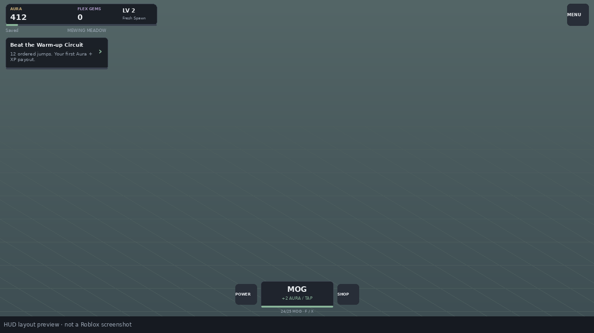

# New-Roblox-Game

## MOG MODE

Click to build Aura, upgrade Mog Power, beat obbies for XP and exclusive pets, and unlock four islands beyond Mewing Meadow. The goal card always shows a next step. A compact charcoal HUD, muted island palettes, small reward effects, and distinct sound cues leave the game world visible.

**Downloads:** [Complete source ZIP](https://github.com/harrydavies1/New-Roblox-Game/archive/refs/heads/main.zip) · [Ready-to-open Studio game](https://github.com/harrydavies1/New-Roblox-Game/raw/refs/heads/main/releases/MogMode.rbxl)

Open `releases/MogMode.rbxl` in Roblox Studio on Windows or macOS and press **Play**. No uploaded art, animation IDs, or credentials are needed to preview it. To keep progress between sessions, publish a private Roblox test experience and enable **Studio Access to API Services** in its Security settings. An unpublished place or unavailable Studio API uses a clearly labelled **Preview · saving off** mode. Real Robux purchases are disabled in Studio.

### What is included

- **Five isolated islands:** Mewing Meadow, Brotein Boulevard, Rizz Reef, Sigma Summit, and Final Boss Citadel. Each has themed scenery, 12 renewable crystals, shops, portals, and three courses. Islands are 6,000 studs apart; the client also hides scenery and prompts from other islands, including retained streamed instances.
- **15 obbies / 330 ordered stages:** 12-jump Warm-up Circuit, 22-jump Hop to the Top, and 32-jump No-Cap Gauntlet on every island. Narrow landings, changing elevation, alternating turns, expert hazards, and checkpoints replace the old short stairs. Checkpoints and finishes award Aura; finishes are the main XP route.
- **25 pets:** 15 guaranteed Aura adoptions and ten exclusive hard/expert first-clear pets. Exclusive pets cannot be bought. Higher adoption and training prices, ten training levels, animated followers, level stars/crowns, three equip slots, and model previews give pets a longer progression path.
- **Slower progression:** more expensive power upgrades and island unlocks, a steeper XP curve, nine ranks, 200 levels, 60 power upgrades, 20 rebirths, daily tasks, and 11 journal milestones. See [progression and rewards](docs/PROGRESSION.md).
- **Return rewards:** no reward on the first day. The first claim unlocks 24 hours after the first saved visit; later claims are 24 hours apart. Seven Aura rewards cycle without losing a streak for missing a day. Flex Gems are never earned from gameplay.
- **Smaller UI and effects:** one menu button, one next-objective card, a small MOG button with cooldown fill, responsive panels, pet previews, save status, optional effect settings, layered reward sounds, dry taps, and quieter travel/reset cues. Floor surfaces have distinct heights, bloom is reduced, and only 30 of 2,218 map parts use Neon.
- **Server authority:** a 0.2-second click cooldown on both client and server, burst capacity of one, checked world/proximity/ordered-stage rewards, durable first clears and login claims, leased save sessions, and atomic paid-receipt deduplication. The cooldown caps accepted clicks at five per second; it cannot prove whether a permitted click came from an autoclicker.

The images below show geometry exported from the actual HUD code. They are layout previews, **not Roblox engine screenshots**.



[Phone HUD layout preview](docs/hud-phone.png)

### Saving

Published Roblox servers use DataStore `MogMode_Profiles_v1`. Schema-one profiles migrate to schema two while preserving existing currency, receipts, owned pets, unlocked islands, styles, and progression. New fields store course first clears/reward cooldowns, login timestamps, and paid boost expiry times.

Autosave runs every 30 seconds, with saves on leaving and shutdown. Course completions, exclusive pets, return claims, and paid deliveries commit before their rewards are shown. A failed course save grants no finish reward and lets the player step off and back onto the finish to retry. The HUD reports pending saves and retries; Settings includes **Save now**. Live servers refuse an unsafe profile load instead of replacing it with temporary progress.

Currencies, XP, upgrades, rebirths, pets, islands, journal/tasks, cosmetics/settings, login progress, completed courses, reward cooldowns, and boost timers persist. An active course checkpoint belongs to the current run; it does not resume after leaving the server. Ordinary play since the last successful save may be lost if the server crashes.

`StudioUseLiveDataStores = true` attempts real saving in a published Studio test place. If API access is unavailable, `AllowStudioSandboxFallback` permits the visibly labelled temporary preview; login claims and real purchases stay disabled there. Use a separate private test experience for save and commerce testing so Studio cannot change production profiles. Publishing this cloud workspace does not publish a Roblox experience.

### Currency and live purchases

Aura comes from gameplay and optional Robux packs; it buys power, pet adoption/training, island unlocks, and rebirths. Flex Gems come **only** from Robux Developer Products and buy guaranteed cosmetics. No paid random eggs are used. All islands, courses, and pets are accessible through play.

The menu, desktop shortcut, island kiosks, and power panel provide optional shop access. Purchases require deliberate selection and a reward/price confirmation before Roblox's native prompt. There are no timed forced purchase pop-ups. All product and pass IDs are initially zero in [`src/server/ServerSettings.luau`](src/server/ServerSettings.luau); configure products belonging to your experience in Creator Dashboard and choose prices there. Unconfigured offers remain unavailable.

| Developer Product key | Guaranteed reward |
| --- | --- |
| `aura_small` | 5,000 Aura |
| `aura_medium` | 60,000 Aura |
| `aura_large` | 750,000 Aura |
| `aura_vault` | 25,000,000 Aura |
| `aura_empire` | 1,000,000,000 Aura |
| `flex_gems_small` | 100 Flex Gems |
| `flex_gems_medium` | 350 Flex Gems |
| `flex_gems_large` | 900 Flex Gems |
| `aura_boost` | 2× click/crystal Aura for 15 minutes |
| `xp_boost` | 2× gameplay XP for 15 minutes |

Boost timers persist, run offline, and stack duration when bought again. Bought Aura does not count toward earned-Aura goals. `DoubleAura` permanently doubles click/crystal Aura; `ExtraPets` adds two equip slots; `VIP` adds the Prismatic Ribbon and Mog Patron nameplate. Pass ownership is verified by Roblox.

Prices come from Roblox; the native prompt shows the final charge. `ProcessReceipt` saves the exact reward and receipt ID together before acknowledging delivery. Failures remain pending for retry; a full currency balance defers the entire reward. Never prune receipt IDs or reuse a sold product ID for a different reward.

### Development and verification

On Linux x86_64 with Python 3, curl, and Git:

```bash
bash tools/check.sh
```

The installer checks pinned SHA-256 digests for Rojo 7.7.1 and Luau 0.745. The script analyzes pure modules, compiles all 20 game scripts, runs 118 core tests, exercises actual UI/server/service source against explicit boundary fakes, checks generated config/map consistency, builds both place formats, and inspects embedded scripts and map geometry. Coverage includes 385 UI scenarios across five viewports, 450 model previews, 124 existing and 177 new service assertions, and 42 real server-entry handler assertions. These are CLI checks, not Roblox engine playtests.

In the prepared cloud environment, reuse cached tools with:

```bash
MOG_TOOL_DIR=/workspace/.roblox-tools bash tools/check.sh
```

Balance, catalogues, courses, and world palettes live in `assets/game.json`. Regenerate the shared Luau config and map together after editing it:

```bash
python3 tools/generate_config.py
python3 tools/build_world.py
bash tools/check.sh
python3 tools/package.py
```

`tools/build_world.py` also uses the editable baseline `assets/base-world.rbxmx`. Commit generated `src/shared/Config.luau`, `src/world/MogWorld.rbxmx`, and `releases/` with their source changes. Server settings and runtime scripts are not overwritten by generation.

`tools/package.py` copies the verified build to `releases/MogMode.rbxl`, writes source/game SHA-256 hashes to `releases/manifest.json`, and creates `build/MOG-MODE-source.zip`. The ZIP includes all source, maps, tests, tooling, docs, and the ready-to-open place, excluding Git internals and tool caches. Build/test outputs under `build/` are ignored.

The optional `python3 tools/render_hud.py` renders the documented layouts after contract tests and requires Pillow; Pillow is not required to build or test the game. For desktop source syncing with a matching Rojo plugin:

```bash
export PATH="$PWD/.tools/bin:$PATH"
rojo serve default.project.json --address 127.0.0.1 --port 34872
```

Cloud loopback is not automatically reachable by desktop Studio; opening the built place is the direct workflow. No Roblox upload is performed. Sounds use bundled Roblox tap, jump, landing, water, and ping assets with short envelopes; map/pet art uses original primitives.

**Validation limit:** Linux CLI checks cannot establish real rendering, jump difficulty, touch/gamepad behavior, audio quality, live DataStore behavior, or purchase delivery. Complete the [Studio test pass](docs/STUDIO_TESTING.md) before public release. [Recovery provenance](docs/RECOVERY.md) records the earlier recovered version.
